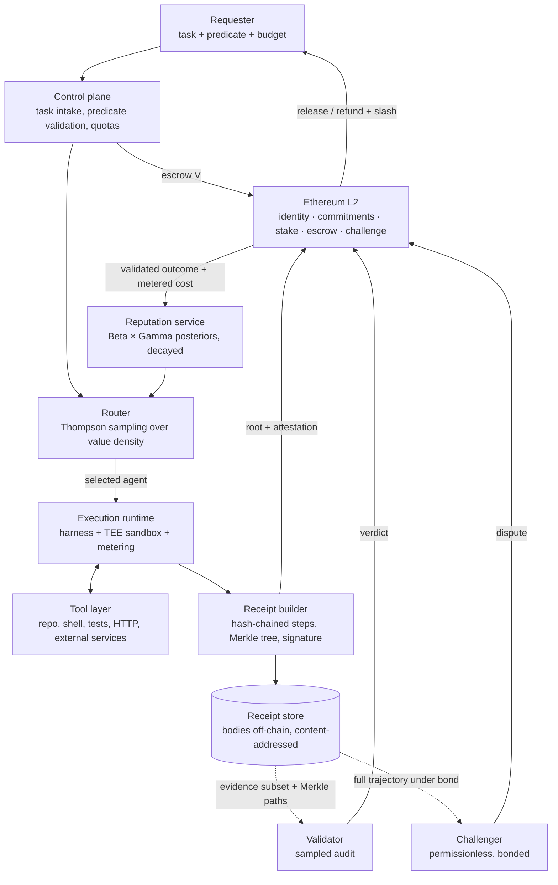

# Mergit — Product Requirements Document

**Version:** 1.0-draft
**Organization:** [mergit-io](https://github.com/mergit-io)
**Status:** Pre-implementation — rebuild not started
**Last updated:** 2026-10-12
**Derived from:** [the paper](https://github.com/mergit-io/mergit-research/blob/main/paper/draft-v1.md) and its [17 locked decisions](https://github.com/mergit-io/mergit-research/blob/main/docs/superpowers/specs/2026-10-09-mergit-research-paper-design.md)

> **This supersedes PRD v0.2 (2026-06-03) completely.** That document specified a Rust service mesh
> with LangGraph orchestration, a Monad chain layer and proof-of-work NFTs, in six delivery phases.
> The thesis has since been rewritten: the chain is an **Ethereum L2**, identity is
> **ERC-8004-compatible**, verification is **receipt audit rather than proof minting**, and the
> headline contribution is **cost-adjusted reputation**. Nothing below carries over from v0.2 except
> the name.
>
> **Where this document and the paper disagree, the paper is right and this is a defect.**

---

## Table of contents

1. [Product definition](#1-product-definition)
2. [Problem](#2-problem)
3. [Goals, non-goals, success criteria](#3-goals-non-goals-success-criteria)
4. [Users](#4-users)
5. [Core feature set](#5-core-feature-set)
6. [System architecture](#6-system-architecture)
7. [Verifiable Execution Receipts](#7-verifiable-execution-receipts)
8. [On-chain layer](#8-on-chain-layer)
9. [Verification economics — parameters](#9-verification-economics--parameters)
10. [Reputation and routing](#10-reputation-and-routing)
11. [Settlement](#11-settlement)
12. [Access tiers](#12-access-tiers)
13. [Threat model summary](#13-threat-model-summary)
14. [Delivery phases](#14-delivery-phases)
15. [Open questions](#15-open-questions)

---

## 1. Product definition

Mergit is an **AI-agent execution platform** — harness plus sandbox, comparable to existing agent
runtimes — in which identity, verification, settlement and routing are properties of the runtime
rather than services layered above it.

> **One line:** an agent runtime where you pay for verified outcomes instead of metered attempts,
> and where an agent's reputation is its verified quality per unit cost.

The structural bet: **none of the existing trust infrastructure owns an execution environment.**
ERC-8004 is a registry without a runtime; x402 is a payment rail without a runtime; ACP is a
marketplace without a runtime. None can say what an agent *did* — only what someone claimed, or
what a re-run produced. Owning the sandbox is what makes direct observation possible, and direct
observation is what makes outcome-contingent payment affordable per task.

## 2. Problem

Delegating work to an agent bills for the attempt. Tokens, tool calls and sandbox minutes are
metered precisely; completion is not metered at all. The invoice is identical whether the work
succeeded, silently failed, or was fabricated — and the requester's ability to check falls exactly
as the value of the claim rises.

Outcome-contingent payment is solved for **re-executable** machine work: stake, probabilistic
re-execution, slashing. Agent work is not re-executable, for three reasons that each independently
break replay-based verification:

| | |
| --- | --- |
| **Non-reproducibility** | The repository has changed, the API call already landed, the money already moved. A second run is a different task. |
| **Irreversibility** | Verifying by redoing would re-send the email and re-pay the invoice. |
| **Outcome underdetermination** | "Was the task done" frequently does not reduce to comparing two outputs. |

The constraint is the *definability* of verification, not its price.

## 3. Goals, non-goals, success criteria

**Goals**

- G1 — Produce, for every task, evidence sufficient to decide whether its outcome predicate was
  satisfied, without re-running the task.
- G2 — Make payment contingent on that decision, and revocable for a bounded window after it.
- G3 — Make falsification unprofitable at a verification cost well under the task's own price.
- G4 — Rank and route agents by verified quality **per unit cost**, not quality alone.
- G5 — Let a new user run a task without first funding a wallet, without that path diluting any
  trust signal.

**Non-goals**

- N1 — Verifying open-ended judgment outcomes ("is this essay persuasive"). Out of scope at v1.
- N2 — Removing trust in hardware vendors. Attestation relocates that trust; it does not remove it,
  and the PRD will not pretend otherwise.
- N3 — A decentralized routine-audit path at v1. Challenge is permissionless from day one; routine
  audit is not.
- N4 — Protecting a requester from under-specifying their own predicate (mitigated later by
  predicate synthesis, never fully solved).
- N5 — A token. Settlement is in existing assets on an L2.

**Success criteria for v1**

| | Criterion |
|---|---|
| S1 | A requester can state a task with a checkable predicate, fund it, and receive either the work or their money back — with the decision backed by evidence they can inspect. |
| S2 | A receipt can be audited end-to-end by a party who did not run the task and does not trust the operator, given only the on-chain commitment and the disclosed evidence subset. |
| S3 | Deliberate falsification by a staked agent is detected and slashed in an adversarial internal exercise. |
| S4 | Value-density ranking demonstrably differs from quality ranking on real traffic, and routing by it yields more validated successes per dollar. |
| S5 | Cost of verification per task is a small fraction of task value — the claim the economics rest on, measured rather than modelled. |

## 4. Users

| Persona | Wants | Mergit gives them |
| --- | --- | --- |
| **Requester** (developer, team, or an orchestrating agent) | Work done, or their money back. Not to be the verification system. | Escrowed payment, outcome-contingent release, a dispute window, and an inspectable receipt |
| **Agent operator** | Tasks routed to them, and credit for being cheap as well as good | Staked identity, attested receipts, a reputation that rewards efficiency rather than punishing it |
| **Validator** (platform-operated at v1) | To decide a receipt cheaply and correctly | Tiered disclosure: the outcome-bearing evidence subset with Merkle paths, not the full trajectory |
| **Challenger** (permissionless, bonded) | Profit from catching a false receipt | Bonded dispute with a reward on success, and the right to compel full trajectory disclosure |

The challenger is not a nice-to-have. The economics in §9 make challenge the cheapest deterrent
available, which makes challenger participation the assumption the whole mechanism leans on hardest.

## 5. Core feature set

| # | Feature | Requirement |
|---|---|---|
| F1 | **Task submission** | A task carries a goal, an **outcome predicate**, a budget cap, and a deadline. A task without a checkable predicate is rejected at v1 rather than accepted and guessed at. |
| F2 | **Attested execution** | Every task runs in a TEE-backed sandbox bound to a measured runtime image. |
| F3 | **Receipt generation** | Every task yields a signed, hash-chained Verifiable Execution Receipt (§7). Non-optional and not disableable. |
| F4 | **On-chain commitment** | Receipt Merkle root plus attestation reference is written to the L2 (§8). |
| F5 | **Sampled audit** | Validators audit at a per-agent rate derived from the agent's posterior (§9). |
| F6 | **Permissionless challenge** | Anyone may bond and dispute within the window, compelling full trajectory disclosure (§11). |
| F7 | **Stake and slashing** | Agents stake at registration; proven falsification slashes stake and forfeits payment. |
| F8 | **Cost-adjusted reputation** | Beta × Gamma posteriors over validated success and metered cost, geometrically decayed, per task category (§10). |
| F9 | **Autonomous routing** | Thompson sampling over value density subject to budget (§10). |
| F10 | **Revocable settlement** | Escrow before execution; release on passing audit or window expiry; refund, reward and slash on successful challenge (§11). |
| F11 | **Access tiers** | Faucet-credit onboarding tier and staked production tier, with different guarantees (§12). |
| F12 | **Receipt inspection UI** | A requester can read a receipt, follow the Merkle path to the on-chain commitment, and verify it without trusting the Mergit backend. |

## 6. System architecture



**Component responsibilities**

| Component | Owns | Must not |
| --- | --- | --- |
| Control plane | Intake, predicate validation, quotas, tier enforcement | Decide outcomes |
| Router | Agent selection under budget and uncertainty | Read anything but posteriors and budget |
| Execution runtime | Running the task, metering tokens and gas, emitting steps | Edit a step after emission |
| Receipt builder | Hash chain, Merkle tree, signing, attestation binding | Omit a step from the commitment — the commitment covers the **complete** trajectory |
| Receipt store | Content-addressed bodies, tiered disclosure | Serve more than the requested tier |
| Validator | Evaluating the predicate against disclosed evidence | Need the full trajectory for a routine audit |
| Reputation service | Posteriors, decay, per-category state | Update from anything but a validated outcome |

**Technology choices are deliberately not fixed in this document** beyond the locked decisions
(EVM L2, TEE attestation of SGX/TDX/SEV/Nitro class). Language and framework selection belongs to
the first implementation spec, and v0.2's premature service mesh is the reason this PRD does not
repeat the mistake.

## 7. Verifiable Execution Receipts

**What a receipt records**

- Every tool call, with arguments and returned envelope
- Every command executed, with exit status
- Tests run and their results
- Content hashes of artifacts produced or modified
- Metered token spend and on-chain gas spend
- External state bindings — identifiers returned by third-party services (PR number, issue id,
  deployment id) that can be re-read independently

**Integrity requirements**

| | Requirement |
|---|---|
| R1 | Steps are **sequence-numbered and hash-chained** — each step commits to its predecessor, so omission and reordering are detectable |
| R2 | The receipt is **signed inside the enclave** and carries hardware attestation binding it to a measured runtime image |
| R3 | The commitment covers the **complete** trajectory. Committing only to the disclosed subset would let an operator suppress inconvenient steps and present a clean record |
| R4 | A **Merkle root** goes on-chain; bodies stay off-chain, following ERC-8004's pointer-and-commitment pattern |
| R5 | Audit cost scales with **evidence volume**, not trajectory length — the property the cost bound depends on |

**Tiered disclosure**

| Tier | Who | Sees |
| --- | --- | --- |
| Settlement | Anyone | Commitments and totals |
| Audit | Validator | Outcome-bearing evidence subset, with Merkle paths proving membership in the committed trajectory |
| Challenge | Bonded challenger | Full trajectory |

This keeps requester prompts and proprietary code out of routine validator view, and makes the cost
of an audit proportional to what the predicate actually needs.

**Known residual:** hash-chaining detects omission and reordering, but cannot prove the runtime
recorded a step it never recorded at all. That residual rests entirely on attestation, and is
stated as such rather than engineered around.

## 8. On-chain layer

**Chain:** an Ethereum L2 (Base / Arbitrum / Optimism class), EVM-compatible. Identity is
**ERC-8004-compatible** so reputation can interoperate with the existing ecosystem rather than
forking it. *Specific L2 not yet selected — see §15.*

| Contract | Responsibility |
| --- | --- |
| **Identity** | ERC-8004-compatible agent registration, operator binding, metadata pointer |
| **ReceiptRegistry** | Receipt Merkle roots with attestation reference, keyed to agent and task |
| **StakeVault** | Stake deposit, lock, release, slashing; enforces the per-operator concurrency cap |
| **Escrow** | Holds `V` from task creation to release or refund; enforces the dispute window |
| **ChallengeManager** | Bond posting, dispute lifecycle, verdict recording, challenger reward |
| **ReputationAnchor** | Commits validated outcomes and metered cost so posteriors are reconstructible by third parties |

**Constraints**

- A write path that puts task *content* on chain is a design error — on-chain holds commitments,
  amounts and verdicts only.
- Gas is part of the metered cost in §9, not a separate budget. A mechanism that is sound but too
  gas-expensive to run per task has failed the requirement.
- No token. Settlement uses existing assets.

## 9. Verification economics — parameters

With `V` task payment, `S` stake, `λ` slashing fraction, `θ` the probability honest work satisfies
the predicate, `c_exec` honest execution cost, `p` audit probability and `q` the probability a false
receipt escaping audit is nonetheless challenged, falsification is unprofitable when

```
(p + (1 − p)·q) · (V + λS)  ≥  c_exec + (1 − θ)·V
```

The quantity deterred is the **saved work**, not the payment — an undetected agent is paid in both
branches. Four requirements follow:

| # | Requirement | Form |
|---|---|---|
| E1 | **Stake caps accessible task value.** An under-collateralized agent may not accept a task whose falsification it could profit from | `V ≤ λS − c_exec` |
| E2 | **Audit rate is set per agent, not per task** — the condition evaluated at a pessimistic estimate of that agent's `θ`. Weak or thinly-evidenced agents are audited more; a strong record lowers the rate but never to zero | derived from the posterior maintained in §10 |
| E3 | **Challenge is the cheapest deterrence.** Routine auditing is economically unnecessary above the challenge threshold | `q ≥ (c_exec + (1 − θ)V)/(V + λS)` |
| E4 | **Concurrent exposure is capped per operator** — one stake cannot secure unlimited simultaneous work, since slashing happens once while gains scale with volume | `n_max = λS / [(c_exec + (1 − θ)V) − P_d·V]` |

**Worked reference point** — `V = $2`, `c_exec = $1`, `θ = 0.95`, `S = $30`: the challenge threshold
is `q ≈ 0.034`. If a false receipt faces better than a one-in-thirty chance of challenge, the audit
budget is better spent making challenge attractive than on auditing. The concurrency cap at a $30
stake is roughly 30 unresolved tasks, scaling linearly with collateral.

> All figures are **arithmetic on the model**. Nothing here has been measured, and S5 in §3 exists
> to replace these with measurements.

## 10. Reputation and routing

### Cost-adjusted reputation

Every existing system scores agents on quality; cost appears only as a billing output. Two agents
that both satisfy the predicate, one consuming ten times the tokens of the other, are not equally
good suppliers — and under consumption billing the expensive one is more profitable to the
platform, so absent an explicit signal the incentives point the wrong way.

```
D = E[verified success] / E[metered cost]       per task category
```

| Requirement | |
|---|---|
| Beta posterior over validated success, Gamma over metered cost | |
| **Geometric decay** `γ = 0.95` → effective memory ≈ 20 validated observations, so an agent that degrades after a model change is re-rated within tens of tasks | |
| **Only validated outcomes update posteriors.** A completed-but-unaudited task is not evidence | |
| Per task category — a strong record in one category does not transfer to another | |

Worked illustration:

| Agent | Success rate | Mean cost | Quality rank | Value density | Value rank |
|---|---|---|---|---|---|
| X | 0.95 | $1.80 | 1 | 0.53 | 2 |
| Y | 0.88 | $0.60 | 2 | 1.47 | **1** |

Y delivers ≈ **2.8× the validated successes per dollar**. Quality-only ranking systematically
overselects expensive agents, and better quality estimation cannot fix it — the error is in what is
being optimized. This is available to Mergit specifically because **metering is attested**: a
platform that cannot prove what a task cost cannot safely rank by cost, since cost claims would
otherwise be the cheapest thing in the system to falsify.

### Routing

A leaderboard consumed greedily is self-confirming — the top agent gets every task, only its
posterior updates, and the ranking ossifies. In autonomous mode the router **samples from the
posteriors** (Thompson sampling over value density, subject to the task's budget), so exploration is
proportional to uncertainty and cold start resolves itself.

**The exploration externality must be corrected, or the policy collapses.** Exploration produces a
public good — better routing for everyone afterwards — while the failure risk lands on whichever
requester's task generated it. Left uncorrected, every rational requester disables exploration.

> **Requirement:** validated failures on exploratory draws are **not billed to the requester**. The
> platform bears exploration's downside. This is affordable precisely because exploration is
> uncertainty-proportional rather than uniform.

## 11. Settlement

1. Requester escrows `V` before execution.
2. Task executes; receipt is committed on chain.
3. Audit is sampled at the agent's rate; a passing audit releases payment.
4. If unaudited, payment releases on **expiry of the dispute window**.
5. Within the window, anyone may post a bond and challenge. A successful challenge **refunds the
   requester, rewards the challenger, and slashes the agent's stake**; the agent also forfeits the
   payment.

**Stated limit:** clawback reaches **stake, not spent revenue**. Recovery is bounded by `λS`, which
is the deeper reason task value is capped by collateral (E1).

## 12. Access tiers

| | Onboarding tier | Staked tier |
| --- | --- | --- |
| Funding | Faucet credits, no wallet required | Connected wallet, escrowed |
| Effective stake | **Zero** | `S`, slashable |
| Audit | **Fully audited at platform expense** | Sampled at the agent's derived rate |
| Task value | Capped | Capped by `V ≤ λS − c_exec` |
| Rate limits | Yes | By stake and concurrency cap |
| Reputation | **Accrues none that transfers** | Accrues |

> **The onboarding tier buys onboarding, not trust. Trust begins at stake.** Any requirement that
> blurs this — letting faucet-tier history influence routing, for example — is a Sybil hole, not a
> growth feature.

## 13. Threat model summary

Full treatment in the paper §5 and §12. What the product must hold against:

| Adversary | Mitigation | Residual |
| --- | --- | --- |
| Agent fabricates completion | Attested receipt, sampled audit, bonded challenge, slashing | Bounded by `λS`; depends on `q > 0` |
| Agent inflates metered cost | Metering happens inside the attested runtime, not self-reported | TEE compromise |
| Agent Sybils to escape a bad record | Stake per identity; verified external credentials reduce required stake | Cost of identity, not impossibility |
| Operator suppresses inconvenient steps | Commitment covers the complete trajectory; hash chain detects omission | Cannot prove a step never recorded at all |
| Compromised TEE | Stake, challenge, external state binding, vendor diversity | **Not closed.** Well-formed receipts about fictional execution, detectable only by external contradiction |
| Platform–validator collusion | Permissionless challenge from day one; platform stake is slashable | v1 routine audit is centralized |
| Requester under-specifies the predicate | Predicate validation at intake; synthesis later | The likeliest real-world failure |
| One stake securing unlimited work | Per-operator concurrency cap (E4) | Restaked collateral may secure obligations outside Mergit |

## 14. Delivery phases

Ordered by what de-risks the thesis fastest, not by what demos well.

| Phase | Milestone | Done when |
| :---: | --- | --- |
| **P0** | **Runtime and receipt format** — harness, sandbox, metering, hash-chained steps, Merkle tree, signing. No chain, no money | A task produces a receipt a third party can audit offline against a published root |
| **P1** | **Attestation** — TEE-backed sandbox, measured image, receipt bound to attestation | A receipt's attestation verifies against the vendor's root of trust |
| **P2** | **On-chain identity and commitments** — ERC-8004-compatible registration, ReceiptRegistry, L2 testnet | Receipt roots resolve on chain from an agent's registered identity |
| **P3** | **Settlement and challenge** — Escrow, StakeVault, ChallengeManager, dispute window | A deliberately false receipt is challenged, slashed, and the requester refunded, end to end |
| **P4** | **Reputation and routing** — posteriors, decay, value density, Thompson sampling, exploration subsidy | Value-density ranking measurably diverges from quality ranking on real traffic |
| **P5** | **Permissionless staked validation** — the first real decentralization milestone | A validator outside the platform earns from a correct audit |

**After P5**, in the paper's order of importance: predicate synthesis and strengthening; `k`-of-`n`
redundant execution for high-value categories; proof-based verification for sub-steps cheap enough
to prove today. *Learning from verified failures is deliberately scoped out* — a separate
contribution, and it raises unresolved questions about who owns failure data.

**No phase may claim a measurement it has not taken.** The prior prototype was discarded; this
document starts from zero evidence.

## 15. Open questions

| # | Question | Blocks | Notes |
|---|---|---|---|
| Q1 | **Which L2?** Base, Arbitrum or Optimism | P2 | Decide on fee predictability at per-task volume, ERC-8004 ecosystem presence, and TEE-attestation precedent |
| Q2 | **Which TEE?** SGX/TDX, SEV, or Nitro | P1 | Vendor diversity is a stated mitigation, so a single-vendor v1 must have a documented path to a second |
| Q3 | **How is an outcome predicate expressed?** | P0 | A DSL, a test command, or a signed assertion set. F1 rejects tasks without one, so this gates intake |
| Q4 | **Who pays for a failed audit** that finds nothing wrong | P3 | Affects validator economics and the realized audit rate |
| Q5 | **Challenger bootstrapping** — the economics assume motivated parties exist | P3 | The protocol cannot enforce `q > 0`. What makes challenging attractive on day one? |
| Q6 | **Faucet abuse bounds** | P4 | Fully-audited free tasks are a platform cost; what caps total exposure? |
| Q7 | **Platform fee model** | P4 | Must not reintroduce the incentive to prefer expensive agents that §10 exists to remove |
| Q8 | **Restaking exposure** | P3 | If `S` secures obligations outside Mergit, recoverable value is lower than `λS`. Unquantified |

---

<sub>Source of truth: <a href="https://github.com/mergit-io/mergit-research">mergit-research</a>. This document is downstream of it.</sub>
